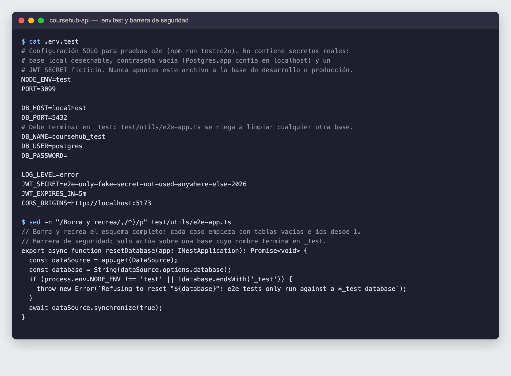
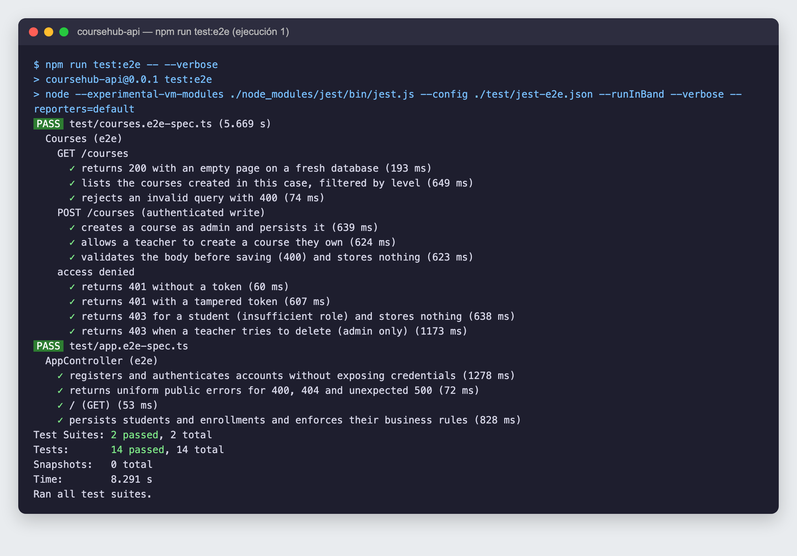
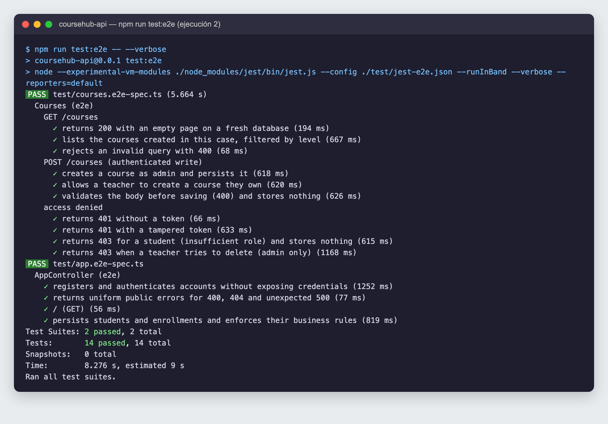
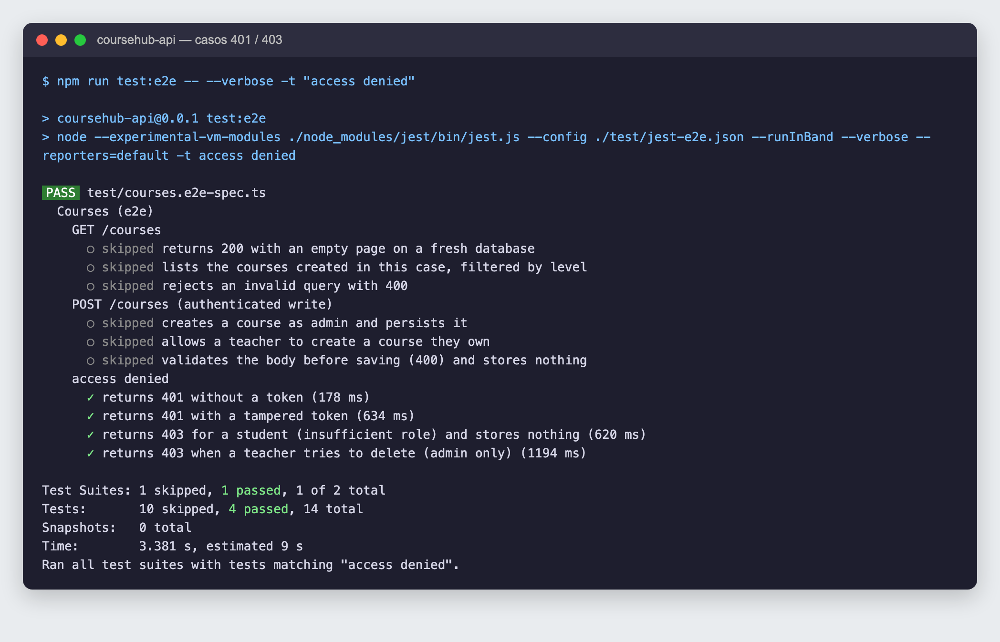
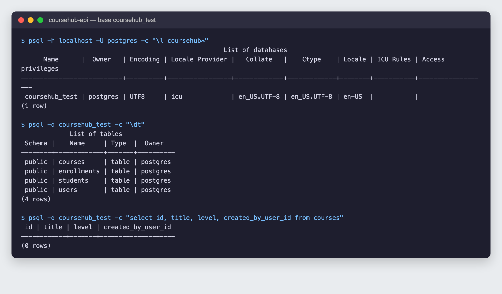
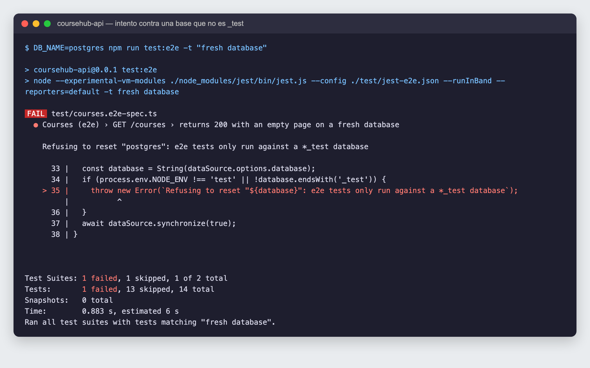
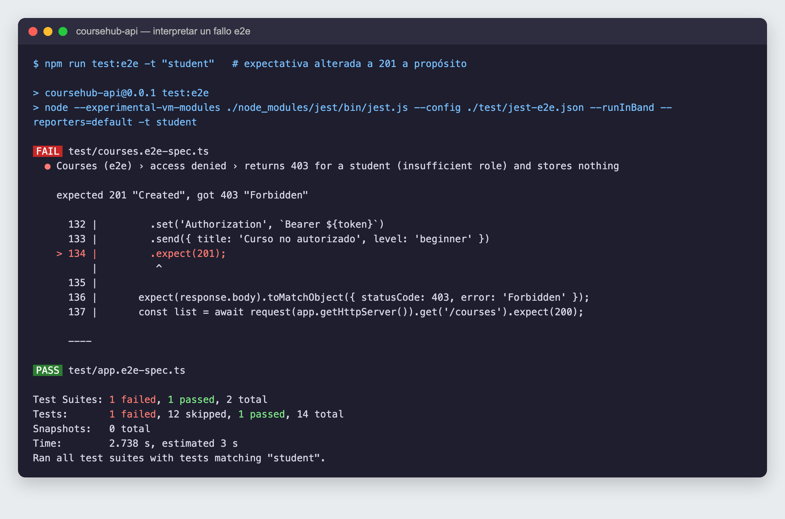

# Sesión 25 · Pruebas de integración y end-to-end

**Meta:** comprobar una operación de la API a través de HTTP con datos aislados y
resultados repetibles.

## 1. Pirámide de pruebas en CourseHub

| Nivel | Qué ejercita | Ejemplo en el proyecto |
| --- | --- | --- |
| Unidad | Una clase con dependencias simuladas | `update-course.use-case.spec.ts`, `courses.controller.spec.ts` |
| Integración | Varias piezas reales de Nest sin base de datos | `courses.controller.auth.spec.ts` (guards + pipes reales) |
| End-to-end | `AppModule` completo + HTTP + PostgreSQL | `test/courses.e2e-spec.ts`, `test/app.e2e-spec.ts` |

Una prueba e2e levanta la aplicación Nest, envía una solicitud HTTP con Supertest
y comprueba la respuesta observable. Así verifica que rutas, guards, pipes,
controlador, caso de uso y persistencia funcionan bien juntos.

## 2. Configuración de prueba sin credenciales reales

- **`.env.test`**: `NODE_ENV=test`, base `coursehub_test`, contraseña vacía (Postgres.app
  confía en localhost) y un `JWT_SECRET` ficticio que no se usa en ningún otro sitio.
- **`src/app.module.ts`**: con `NODE_ENV=test` (Jest lo define), `ConfigModule` lee
  `.env.test` en vez de `.env`. La base de desarrollo nunca se toca.
- **`src/config/typeorm.config.ts`**: se pasa `driver: pg` explícito. Antes, bajo Jest
  ESM, TypeORM no conseguía cargar `pg` (`Cannot read properties of undefined (reading 'Pool')`)
  y **la suite e2e anterior no podía conectarse**.
- **`package.json`**: `test:e2e` usa `--runInBand`. Las dos suites comparten la base
  de prueba, así que se ejecutan una detrás de otra.

Para preparar un equipo nuevo:

```bash
createdb -h localhost -U postgres coursehub_test
npm run test:e2e
```



**Captura 1 – Configuración aislada.** `.env.test` solo tiene valores de práctica.
`resetDatabase` se niega a actuar si `NODE_ENV` no es `test` o si la base no termina
en `_test`.

## 3. Aislamiento: datos limpios en cada caso

`test/utils/e2e-app.ts` reúne tres utilidades:

| Utilidad | Qué hace |
| --- | --- |
| `createTestApp()` | `AppModule` real con el mismo `ValidationPipe` que `main.ts`. Desactiva el throttler, que tiene su propia prueba |
| `resetDatabase(app)` | `dataSource.synchronize(true)`: borra y recrea el esquema, así que las tablas quedan vacías y los ids empiezan en 1 |
| `tokenFor(app, role)` | Registra una identidad de práctica por HTTP, le asigna el rol en la base e inicia sesión para obtener el JWT |

Cada caso hace `createTestApp()` + `resetDatabase()` en `beforeEach` y `app.close()` en
`afterEach`. Por eso **no depende del orden**: puede afirmar `id: 1` y `total: 0`
sin importar qué casos se ejecutaron antes.

## 4. Casos con Supertest (`test/courses.e2e-spec.ts`)

| Caso | Solicitud | Respuesta esperada |
| --- | --- | --- |
| Lista vacía | `GET /courses` | 200, `items: []`, `meta.total: 0` |
| Filtro | `GET /courses?level=intermediate` | 200, solo el curso intermedio |
| Query inválido | `GET /courses?limit=500` | 400 |
| Escritura admin | `POST /courses` con token admin | 201, `id: 1`, `createdByUserId: 1`, persiste |
| Escritura docente | `POST /courses` con token teacher | 201, el docente queda como dueño |
| Body inválido | `POST /courses` `level: 'expert'` | 400 y no guarda nada |
| Sin token | `POST /courses` | **401** |
| Token alterado | `POST /courses` `Bearer <token>x` | **401** |
| Rol insuficiente | `POST /courses` con token student | **403** y no guarda nada |
| Borrado solo admin | `DELETE /courses/1` con token teacher | **403** y el curso sigue existiendo |



**Captura 2 – Primera ejecución.** `npm run test:e2e`: 2 suites y 14 pruebas en verde.
Incluye la suite anterior `app.e2e-spec.ts`, que ahora también usa la base aislada.



**Captura 3 – Segunda ejecución.** Se repite el mismo comando y el resultado es el
mismo: 14/14. Un `diff` entre las dos salidas solo muestra diferencias de tiempo
(ms) y de `requestId`. Eso demuestra que el resultado es repetible.



**Captura 4 – Acceso permitido y denegado.** Con `-t "access denied"` se ejecutan
solo los casos 401 (sin token o con token alterado) y 403 (estudiante creando,
docente borrando). `JwtAuthGuard` responde a la identidad y `RolesGuard` al permiso.



**Captura 5 – Base de prueba independiente.** En PostgreSQL existe `coursehub_test`
con su propio esquema (creado por las pruebas) y ningún dato personal ni de
desarrollo.



**Captura 6 – La barrera protege otras bases.** Si alguien apunta las pruebas a otra
base (`DB_NAME=postgres`), `resetDatabase` lanza
`Refusing to reset "postgres"` antes de borrar nada.

## 5. Cierre: interpretar un fallo e2e

Para practicar, se cambió a propósito la expectativa del caso del estudiante a
`.expect(201)`:



**Captura 7 – Lectura del fallo.**

1. **Qué caso:** `Courses (e2e) › access denied › returns 403 for a student…`
2. **Qué esperaba y qué obtuvo:** `expected 201 "Created", got 403 "Forbidden"`.
3. **Dónde:** la línea 134 señalada con `>`.
4. **Diagnóstico:** la API respondió correctamente (un estudiante no puede crear
   cursos). Lo que estaba mal era la expectativa de la prueba. Si el fallo hubiera
   sido al revés (`expected 403, got 201`), sería un **fallo de seguridad real**: el
   guard de roles no estaría aplicado a la ruta.

Después se restauró `.expect(403)` y la suite volvió a 14/14.

## Criterio de éxito

- [x] Configuración de prueba sin credenciales de producción (`.env.test`, base `_test`).
- [x] `GET /courses` y una escritura autenticada (`POST /courses`).
- [x] Casos 401 sin token y 403 con rol insuficiente.
- [x] Datos reinicializados antes de cada caso (`resetDatabase`).
- [x] El conjunto ejecutado dos veces da el mismo resultado (14/14).
- [x] Funciona en un equipo nuevo con `createdb coursehub_test` + `npm run test:e2e`.
- [x] Las pruebas unitarias siguen en 119/119 y `npm run lint` no da avisos.

Fuente: [Testing · NestJS](https://docs.nestjs.com/fundamentals/testing)
