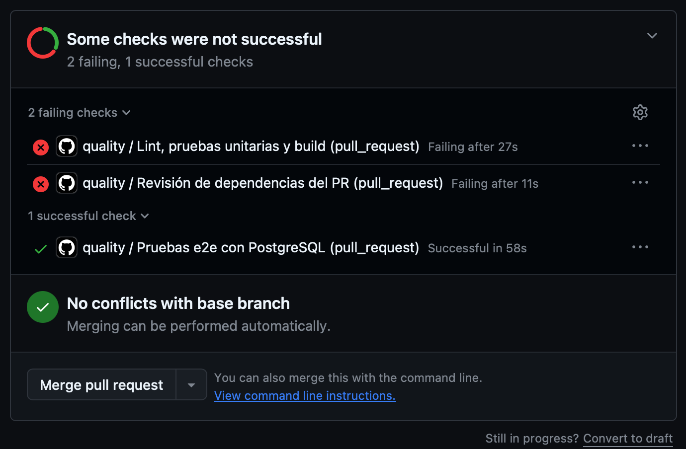
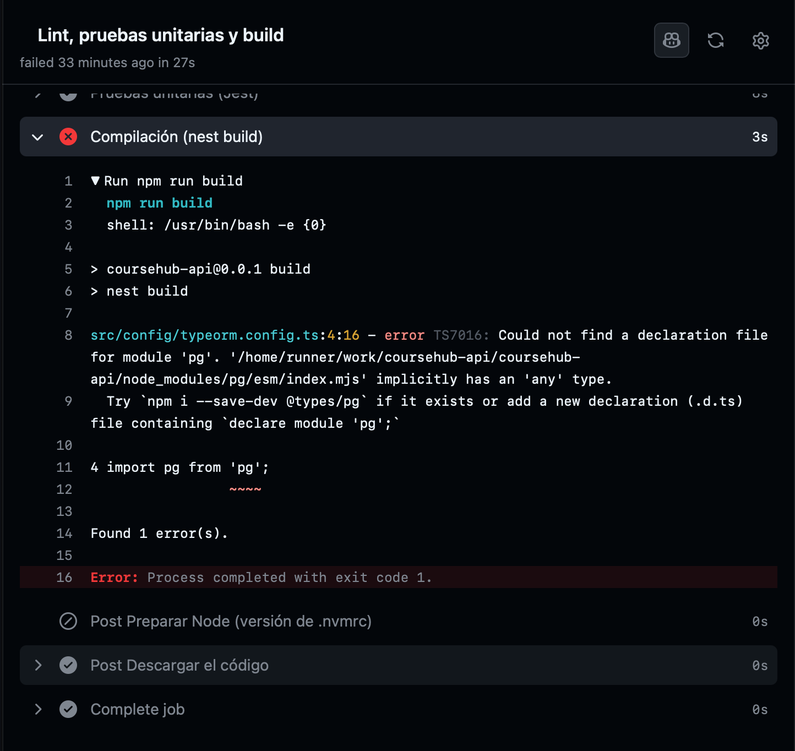
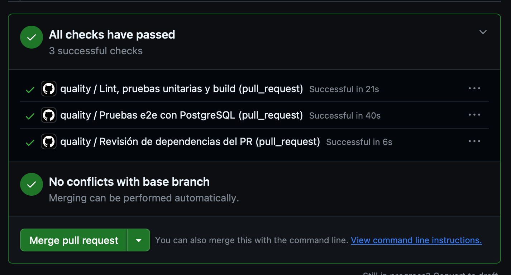
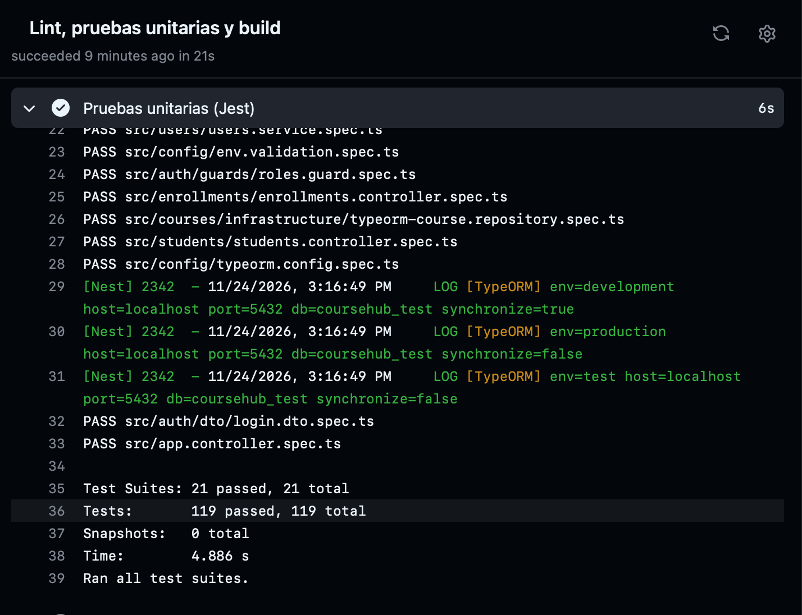
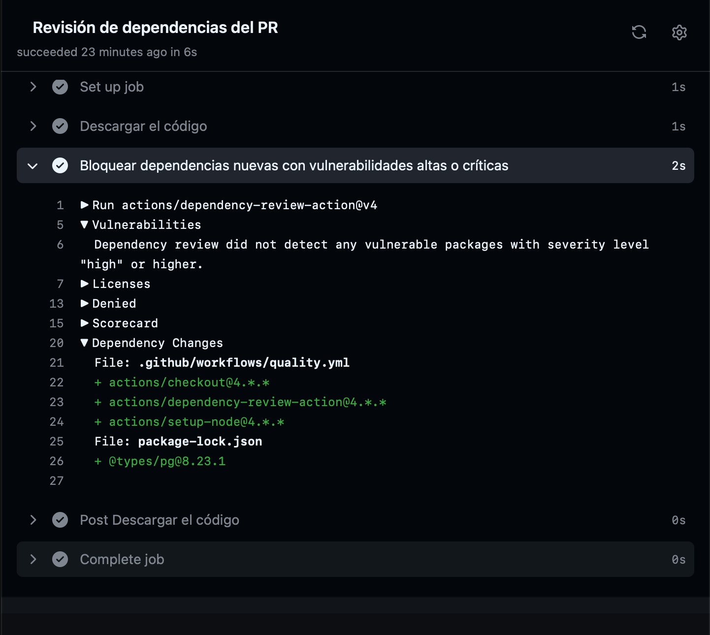

# Sesión 26 · Automatización de calidad con GitHub Actions

**Meta:** automatizar comprobaciones que se ejecuten igual antes de integrar un cambio.

Un flujo de integración continua no reemplaza la revisión de código. Lo que aporta es
una **señal repetible**: en un entorno limpio instala las dependencias desde el archivo
de bloqueo, analiza el código, ejecuta las pruebas y construye el proyecto.

## 1. El flujo `quality`

Archivo: [`.github/workflows/quality.yml`](../.github/workflows/quality.yml)

Se activa en **cada Pull Request** y en **cada push a `main`**. Solo pide permisos de
lectura (`contents: read`). Si llega un commit nuevo a la misma rama, cancela la
ejecución anterior.

| Job | Pasos (cada uno con nombre propio) |
| --- | --- |
| **Lint, pruebas unitarias y build** | Descargar el código → Preparar Node (versión de `.nvmrc`) → **`npm ci`** → **oxlint** → **Jest** (`npm test -- --runInBand`) → **`nest build`** |
| **Pruebas e2e con PostgreSQL** | Servicio `postgres:17` con la base `coursehub_test` → `npm ci` → `npm run test:e2e` (Sesión 25) |
| **Revisión de dependencias del PR** | `actions/dependency-review-action@v4` con `fail-on-severity: high` (solo en PRs) |

**Por qué es reproducible**

- `npm ci` instala **exactamente** las versiones de `package-lock.json`. Si el archivo
  de bloqueo no coincide con `package.json`, falla en vez de resolver versiones nuevas.
- La versión de Node sale de **`.nvmrc`** (24), la misma que se usa en desarrollo.
- La base e2e es un contenedor nuevo en cada ejecución y usa `.env.test`, que no tiene
  credenciales reales.
- **Cada paso tiene un nombre descriptivo**, así se sabe qué control falló sin leer
  toda la salida.

## 2. Fallo controlado: el flujo lo reporta

El primer commit del PR subió **solo el flujo**, sin la corrección. Al reproducir el
flujo en local, en un clon limpio, ya había aparecido un error real: el `import pg from 'pg'`
de la Sesión 25 no tenía declaración de tipos. **Jest no lo detectaba**, porque compila
cada archivo por separado; `nest build` sí.

**Captura 1 – El flujo detecta el fallo.** Al abrir el PR #1, GitHub Actions ejecutó
el flujo `quality` automáticamente. El job **Lint, pruebas unitarias y build** falló
(❌); las **pruebas e2e con PostgreSQL** pasaron (✅). La **revisión de
dependencias** también falló, pero por configuración del repositorio: el
*Dependency graph* estaba desactivado (ver la sección 4).

**Captura 2 – Qué control falló.** Gracias al nombre de cada paso se ve de inmediato
que falló **Compilación (nest build)**, con
`TS7016: Could not find a declaration file for module 'pg'` en
`src/config/typeorm.config.ts:4`. La instalación, el lint y las pruebas unitarias
habían pasado.

## 3. Corrección y estado final

Corrección mínima: agregar `@types/pg` como dependencia de desarrollo. No cambia ningún
comportamiento en tiempo de ejecución, solo aporta los tipos para que TypeScript compile.

**Captura 3 – Estado final en verde.** Después de activar el Dependency graph y subir
la corrección, el flujo se ejecutó otra vez solo y **los 3 controles pasaron**. El PR
queda listo para revisión e integración.

**Captura 4 – Los pasos en verde.** El mismo job que antes fallaba ahora pasa completo.
En un Ubuntu limpio se ejecutan **21 suites y 119 pruebas unitarias** y el proyecto
compila.

## 4. Revisión de dependencias

`dependency-review-action` necesita el **Dependency graph**, que se activa en
*Settings → Code security → Dependency graph → Enable*. Sin él, el job falla con
`Dependency review is not supported on this repository`. Así quedó documentado en la
primera ejecución, en vez de presentar como aprobado un control que no funcionaba.

**Captura 5 – Revisión de dependencias.** En cada PR se revisan **solo las dependencias
que el cambio agrega o modifica**: en este caso las 3 acciones de GitHub y `@types/pg@8.23.1`.
El PR se bloquearía si alguna tuviera una vulnerabilidad alta o crítica. Resultado:
*"did not detect any vulnerable packages with severity level high or higher"*.

### Auditoría de las dependencias que ya existían (`npm audit --omit=dev`)

La revisión del PR solo mira lo nuevo. Las dependencias que ya estaban se auditaron
aparte. **No se aplicó `npm audit fix` a ciegas.** Para cada paquete se identificaron
el origen, la exposición real en CourseHub y la actualización mínima segura:

| Paquete | Severidad | Llega por | ¿Afecta a CourseHub? | Actualización mínima propuesta |
| --- | --- | --- | --- | --- |
| `proxy-addr` 2.0.7 | Crítica | `express` (vía `@nestjs/platform-express`) | Baja: la falla está en la lista de proxies de confianza y la API **no usa `trust proxy`** | Llega al actualizar `@nestjs/platform-express` |
| `@nestjs/platform-express` 12.0.1 | Alta | Directa | Por `multer` (abajo) | **Minor** dentro de 12.x, junto con `@nestjs/core`, `common` y `testing` en la misma versión |
| `multer` 2.2.0 | Alta | `@nestjs/platform-express` | Baja: **no hay endpoints de subida de archivos** | Llega con la anterior |
| `body-parser` 2.3.0 | Alta | `express` | Sí: procesa todos los cuerpos JSON | Llega con la anterior |
| `joi` 18.3.0 | Alta | Directa | Baja: solo valida `.env` y **no usa `email({ multiple: true })`** | **Patch**: `joi@^18.3.2` |
| `qs` 6.16.0 | Moderada | `express`, `supertest` | Baja: el fallo está en `stringify` con `arrayFormat: 'comma'` | Llega con la anterior |

**Plan.** Hacerlo en un PR aparte, en dos commits que el flujo valide por separado:
1. `joi` (patch). Lo cubren `env.validation.spec.ts` y el arranque de la app en e2e.
2. Las dependencias `@nestjs/*` alineadas en la misma versión 12.x. Las cubren las 14
   pruebas e2e: rutas, guards, pipes y cuerpos JSON.

**Herramientas de desarrollo** (`jest`, `@nestjs/cli`, `@nestjs/mau`): `npm audit`
reporta más avisos, y para varios propone como "arreglo" **bajar de versión mayor**
(`jest@29`, `@nestjs/mau@0.0.6`). Eso rompería la configuración ESM actual. No se
instalan en producción, así que quedan **pendientes de revisar** cuando haya versiones
corregidas compatibles.

## Criterio de éxito

- [x] Flujo que se activa en PRs y en pushes a `main`.
- [x] Instalación reproducible (`npm ci` + `.nvmrc`), lint, pruebas unitarias, e2e y build.
- [x] Fallo controlado reportado por el flujo (capturas 1 y 2).
- [x] Revisión de dependencias activa en PRs (captura 5) y auditoría de las existentes documentada.
- [x] Fallo corregido y estado final en verde (capturas 3 y 4).
- [x] Cada paso tiene un nombre que permite saber qué control falló sin leer toda la salida.

Fuentes: [Building and testing Node.js · GitHub Actions](https://docs.github.com/actions/use-cases-and-examples/building-and-testing/building-and-testing-nodejs) ·
[Dependency review action · GitHub Docs](https://docs.github.com/code-security/supply-chain-security/understanding-your-software-supply-chain/configuring-the-dependency-review-action)
